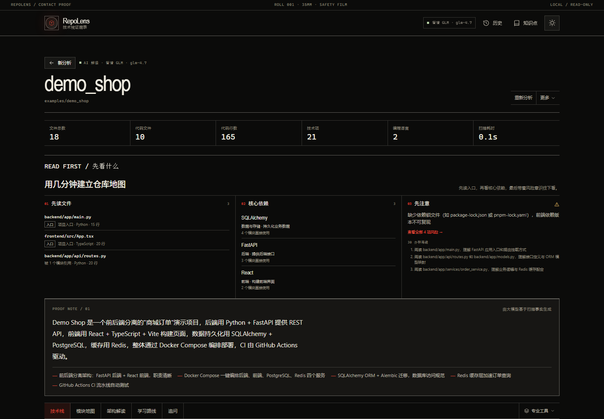

# 报告页 UI 收敛方案

> 状态：待评审  
> 版本：v0.1  
> 日期：2026-11-07  
> 基线：`main` / `0abad75`  
> 范围：报告页前端信息架构与视觉密度；不改 API、报告 schema、扫描器  
> 目标：先解决“同一件事重复解释”和“首屏过重”，暂不引入简易/专业模式开关



---

## 1. 结论

当前报告页的问题不是功能太多，而是：

1. **信息归属不唯一**：风险、学习路线、摘要分别出现在多个区域；
2. **首屏解释层过厚**：统计、先看什么、摘要、警告叠在一起，Tab 和正文被推到首屏以下；
3. **技术栈默认全量展开**：21 项技术一次性铺开，移动端尤其长；
4. **关键说明文字偏小**：多处 8–9px，能看见但不易读。

本方案只做减法与层级整理：

- **不删除任何能力**；
- **不新增模式开关**；
- **不改后端契约**；
- 先完成 P0，再评估 P1；P2 视实际使用反馈决定。

---

## 2. 设计原则

### 2.1 一个内容只有一个“完整归属”

| 内容 | 完整归属 | 其他区域只允许 |
| --- | --- | --- |
| 摘要、亮点 | 报告头摘要 | 无 |
| 入口文件、核心依赖、首个风险 | 先看什么 | 摘要 + 链接 |
| 分层、目录、关键文件 | 架构解读 | 无完整重复 |
| 完整风险列表 | 风险面板 | 首个风险 + 数量 + 链接 |
| 完整学习路线 | 学习路线 Tab | 路线入口 + 步数 |
| 技术卡片与证据 | 技术栈 Tab | 详情抽屉 |

### 2.2 首屏优先回答“这是什么、先读什么”

首屏应该出现：

```text
仓库名 / 来源 / AI 状态
关键统计
先看什么（入口 + 核心依赖 + 首个风险）
Tab
```

摘要可以保留，但不能把 Tab 推到首屏之外。

### 2.3 渐进披露，而不是隐藏能力

- 技术栈默认只显示核心项，其余展开；
- 风险面板保留在“更多视图”；
- 学习路线保留完整 Tab；
- 代码证据、引用核对仍可随时进入。

### 2.4 不新增“简易 / 专业”全局开关

当前问题可以通过内容归属和首屏压缩解决。  
如果先加开关，会多出模式状态、深链接、两套入口的问题，收益低于直接整理内容。

---

## 3. 目标布局

### 当前

```text
报告头
6 格统计
先看什么（3 列）
摘要 + 全部 highlights
警告
Tab
正文
```

### P0 后

```text
报告头（略矮）
4 格统计
先看什么（3 列，路线改为入口）
摘要（highlights 默认 2–3 条）
Tab（更多视图在右侧）
正文
```

警告不再作为独立大块占据首屏；并入风险面板，或压成一行提示。

---

## 4. P0：优先落地

P0 目标：**不改数据、不改交互契约，只改归属、密度和首屏。**

### P0-1 首屏压缩

#### 统计条 6 → 4

当前：

```text
文件总数 / 代码文件 / 代码行数 / 技术项 / 编程语言 / 扫描耗时
```

改为：

```text
文件 / 代码行数 / 技术项 / 风险
```

说明：

- “文件总数”和“代码文件”合并为“文件”，值显示 `18 / 10 代码` 或只显示文件总数；
- “扫描耗时”属于实现细节，移入页脚或技术详情；
- “风险”读取 `report.risks.length`，点击进入风险面板；
- 该数字是**报告风险条数**，风险面板可能补充循环依赖、测试缺失、CI 缺失等结构化发现，因此文案用“风险提示”并在 tooltip/aria 中说明“完整风险见风险面板”，避免两个数字不一致时误导；
- 保留现有 6 列样式在桌面端可改为 4 列，移动端 2×2。

验收：

- 桌面 1440px 下统计条不超过 4 格；
- 风险数字可点击；
- 无风险时显示 `0`。

#### 报告标题与间距

当前仓库名字号已经是 `clamp(32px, 4.6vw, 52px)`，不需要大幅缩小；  
主要压缩来自间距和解释层：

- `.report-head` 底部 padding 从 18px 降到 14px；
- 统计条上下 margin 从 18px 降到 12px；
- 先看什么与统计之间减少一段空距；
- 摘要 highlights 默认只显示 2 条，其余用 `+N` 展开。

目标：

```text
1440×900 首屏内能看到 Tab
1440×1000 首屏内能看到 Tab + 第一段正文
```

#### 警告压成一行

当前 `warnings` 是独立块，位于摘要和 Tab 之间。  
改为：

```text
2 条扫描提示  [查看风险面板 →]
```

- 没有 warnings 时整行不显示；
- 完整 warning 文本由风险面板承接；
- 不再在首屏展开完整 warning 列表。

#### highlights 折叠

当前全部 highlights 一次展示，最多 5 条。  
改为：

```text
— 亮点 1
— 亮点 2
+3 条亮点
```

点击后展开全部；状态只保存在组件内，不写 localStorage。

验收：

- 默认最多 2 条；
- 剩余数量正确；
- 展开/收起不引发布局跳动过大；
- 无 highlights 时不显示该区域。

### P0-2 风险只保留一个完整入口

当前风险出现在：

1. 先看什么：首个风险；
2. 架构解读：完整风险列表；
3. 风险面板：完整风险。

改为：

- **先看什么**：保留首个风险 + `查看全部 N 项风险 →`；
- **架构解读**：删除完整风险 `<ul>`，只保留一行：

```text
检测到 N 项风险  [查看风险面板 →]
```

- **风险面板**：唯一完整来源。

涉及文件：

- `frontend/src/views/ReportView.vue`（先看什么，已具备链接）
- `frontend/src/components/ArchitectureTab.vue`（删除完整列表）
- `frontend/src/components/RiskPanel.vue`（保持）

验收：

- 页面只有一个完整风险列表；
- 架构解读的风险链接可进入 `tab=risks`；
- 无风险时架构解读显示“未发现明显风险”。

### P0-3 学习路线只保留一个正文

当前：

- 先看什么中显示 3 步；
- 学习路线 Tab 显示完整 6 步。

改为：

- 先看什么删除 `<ol>` 三步正文；
- 保留一行入口：

```text
30 分钟路线 · 6 步  [继续 →]
```

- 点击进入学习路线 Tab；
- 完整步骤只在学习路线中出现。

涉及文件：

- `frontend/src/views/ReportView.vue`

验收：

- 先看什么中不出现完整步骤列表；
- 路线入口显示总步数；
- 点击后进入 `tab=learn`；
- 学习路线进度与原有 localStorage 行为不变。

### P0-4 “专业工具”改名为“更多视图”

原因：

- “专业工具”暗示用户不够专业；
- 里面的依赖图、风险、分析过程只是不同视角，不是“专业资格”。

文案：

```text
更多视图 ▾
```

菜单保持：

```text
依赖图 / 风险面板 / 分析过程
```

涉及文件：

- `frontend/src/views/ReportView.vue`

验收：

- 按钮、aria-label、文档统一使用“更多视图”；
- 功能与深链接不变。

### P0-5 关键文字下限 10px

当前多处 metadata 为 8–9px，优先调整这些“需要阅读”的文字，不盲目放大所有装饰文字：

| 位置 | 当前 | 调整 |
| --- | --- | --- |
| 先看什么的文件说明 | 9px | 10px |
| 先看什么的技术副标题 | 9px | 10px |
| 30 分钟路线列表 | 9px | 10px |
| 技术卡底部计数 | 9px | 10px |
| 风险面板证据路径 | 8px | 10px |
| 引用/深度核对说明 | 8px | 9.5–10px |

保留 8–9px 的地方：

- 边缘编号；
- Tab 旁装饰性计数；
- 抽屉 eyebrow；
- 纯装饰性边码。

验收：

- 关键正文与可点击文字不小于 10px；
- 390px 下仍不出现横向溢出；
- 深浅主题对比度保持可读。

---

## 5. P1：技术栈与风险表达

P1 不改后端，只在前端做渐进披露和表达修正。

### P1-1 技术栈默认只显示核心项

当前 21 项技术全部展开。

建议：

- 按“模块数 × 3 + 置信度权重”排序；
- 排除编程语言和其他依赖；
- 默认显示前 8 项；
- 底部：

```text
展开全部 21 项 ↓
```

交互约束：

- 用户主动选择分类或搜索时，显示所有匹配项，不应用“前 8 项”限制；
- “展开全部”后显示原有分组结构；
- 切换报告时重置为收起；
- 不改变 `TechCard` 的点击行为。

待决策：

- 前 8 项是全局排序，还是每个层级各取前 N 项？
- 全局前 8 可能让“测试”“基础设施”层级消失，需要确认是否接受。

### P1-2 移动端分类 chip 可横向滚动

当前 10 个 chip 在移动端换多行，挤压首屏。

建议：

- 390px 下 `.chips` 改为单行横向滚动；
- 保留“全部”固定在最前；
- 右侧渐隐提示可滚动；
- 不改成下拉，避免隐藏分类。

### P1-3 技术卡底部精简

当前每张卡同时显示：

```text
置信度 / 模块数 / 证据数 / AI 推断 / 箭头
```

建议卡片只保留：

```text
置信度 / 模块数 / 箭头
```

证据数、AI 推断标记、具体文件进入 `TechDrawer`。

原因：

- 卡片是“扫读层”；
- 抽屉才是“证据层”；
- 减少每张卡一行 metadata，21 张卡少 21 行。

### P1-4 风险分改为“风险计数”

当前风险面板显示：

```text
26
中风险
4 项
```

这个分数是启发式加权，不是校准评分，容易造成伪精确。

建议二选一：

- 去掉分数，只显示：

```text
4 项风险
2 中 / 2 低
```

- 或保留分数并明确标注：

```text
启发式风险分 26
（不是安全评分）
```

优先方案：去掉大数字，保留严重度计数。

---

## 6. P2：架构解读重构

P0 只删除重复风险和学习路线正文；P2 再处理架构解读本身。

当前架构解读包含：

- 摘要；
- 亮点；
- 分层；
- 风险；
- 学习路径；
- 关键文件。

建议最终只保留：

```text
架构分层
关键目录 / 文件
结构判断
```

摘要、亮点、风险、学习路径各自回到唯一归属。

风险：

- 这是较大的组件重构；
- 需要确认架构解读是否还应承担“项目总结”的角色；
- 建议先完成 P0，观察用户是否还会在架构解读里找摘要。

---

## 7. 技术改动范围

### 前端文件

| 文件 | 改动 |
| --- | --- |
| `frontend/src/views/ReportView.vue` | 统计 4 格、highlights 折叠、先看什么路线入口、更多视图改名、字体调整 |
| `frontend/src/components/ArchitectureTab.vue` | 删除完整风险列表，改为链接 |
| `frontend/src/components/TechCard.vue` | P1 精简卡底 |
| `frontend/src/components/RiskPanel.vue` | P1 风险分表达 |
| `frontend/src/components/LearningPath.vue` | 不改逻辑，仅确保入口文案 |
| `frontend/src/styles/*` | 如需新增 10px 以上的文本 token |

### 不改

- 后端 API；
- 报告 schema；
- 扫描器；
- SQLite；
- URL / Tab key；
- 深链接规则；
- `TABS` 契约。

### 新增状态

只新增组件内状态：

```text
showAllHighlights
showAllTechs
```

不写入 store，不写入 localStorage。

---

## 8. 验收清单

### P0

- [ ] 统计条 4 格：文件 / 代码行数 / 技术项 / 风险；
- [ ] 风险数字可点击进入风险面板；
- [ ] 1440×900 首屏能看到 Tab；
- [ ] 1440×1000 首屏能看到 Tab + 第一段正文；
- [ ] warnings 压缩成一行，完整内容在风险面板；
- [ ] highlights 默认最多 2 条，可展开；
- [ ] 架构解读不再有完整风险列表；
- [ ] 先看什么不再有 3 步正文，只有路线入口；
- [ ] “更多视图”文案替换“专业工具”；
- [ ] 关键说明文字不低于 10px；
- [ ] 390px 无横向溢出；
- [ ] 深浅主题截图各一张。

### P1

- [ ] 技术栈默认 8 项，可展开全部；
- [ ] 搜索/分类时不限制为 8 项；
- [ ] 移动端分类 chip 单行横向滚动；
- [ ] 技术卡底部只保留置信度/模块数/箭头；
- [ ] 风险分去掉或明确标注启发式。

### 回归

- [ ] 43 个测试通过；
- [ ] 4 个多仓库评测通过；
- [ ] `npm run build` 通过；
- [ ] `check_secrets.py` 通过；
- [ ] 所有原有 Tab、深链接、专业工具、更多菜单可用；
- [ ] 引用核对、语义核对、代码查看器不受影响。

---

## 9. 实施顺序

1. **P0-1 首屏压缩 + P0-5 字体**：一次构建，先看首屏效果；
2. **P0-2 风险去重 + P0-3 学习路线去重**：内容归属；
3. **P0-4 文案改名**；
4. 构建、截图、移动端验证；
5. 提交 P0；
6. 根据反馈再决定是否进入 P1。

不建议把 P0 和 P1 混在一次提交里，否则很难判断问题来自“层级”还是“技术栈折叠”。

---

## 10. 待确认

1. 统计条第 4 格用“风险”，还是“技术项 + 风险”保留 5 格？
2. highlights 默认 2 条还是 3 条？
3. 技术栈默认 8 项是全局排序，还是每层各取前 N 项？
4. “更多视图”是否比“全部工具”更合适？
5. 架构解读是否在 P0 只删风险，还是在 P2 一次重构掉摘要/学习路径？

建议默认决策：

- 4 格统计；
- highlights 2 条；
- 技术栈 P1 再处理；
- “更多视图”；
- 架构解读 P0 只删风险。
