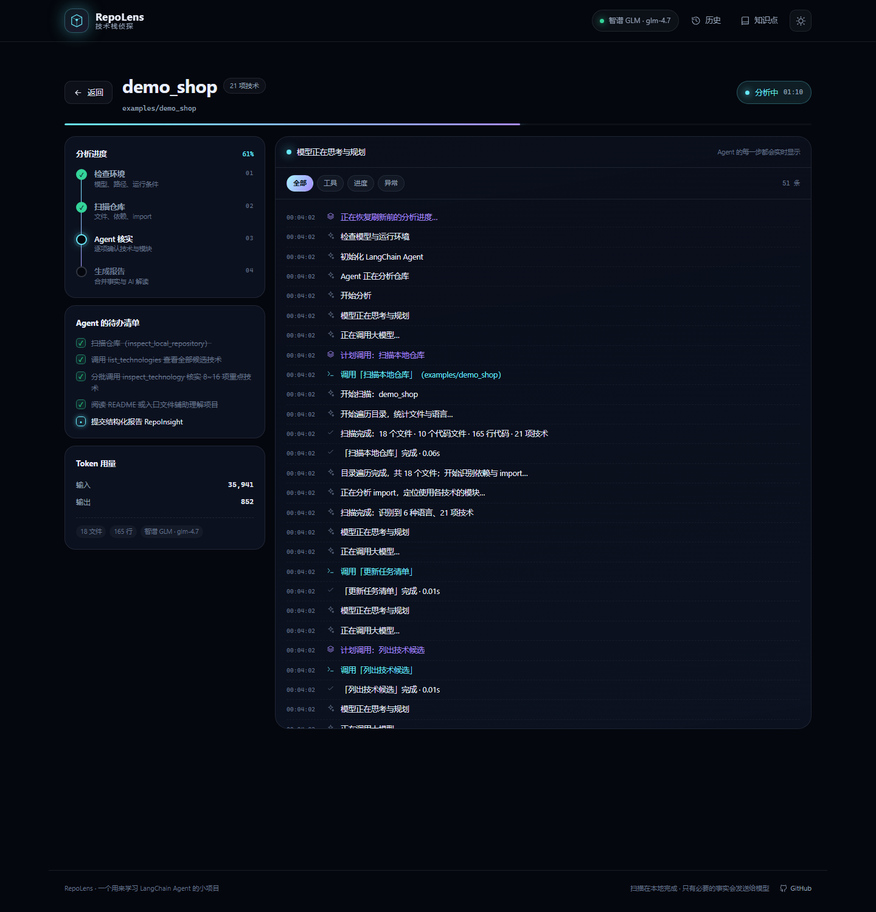
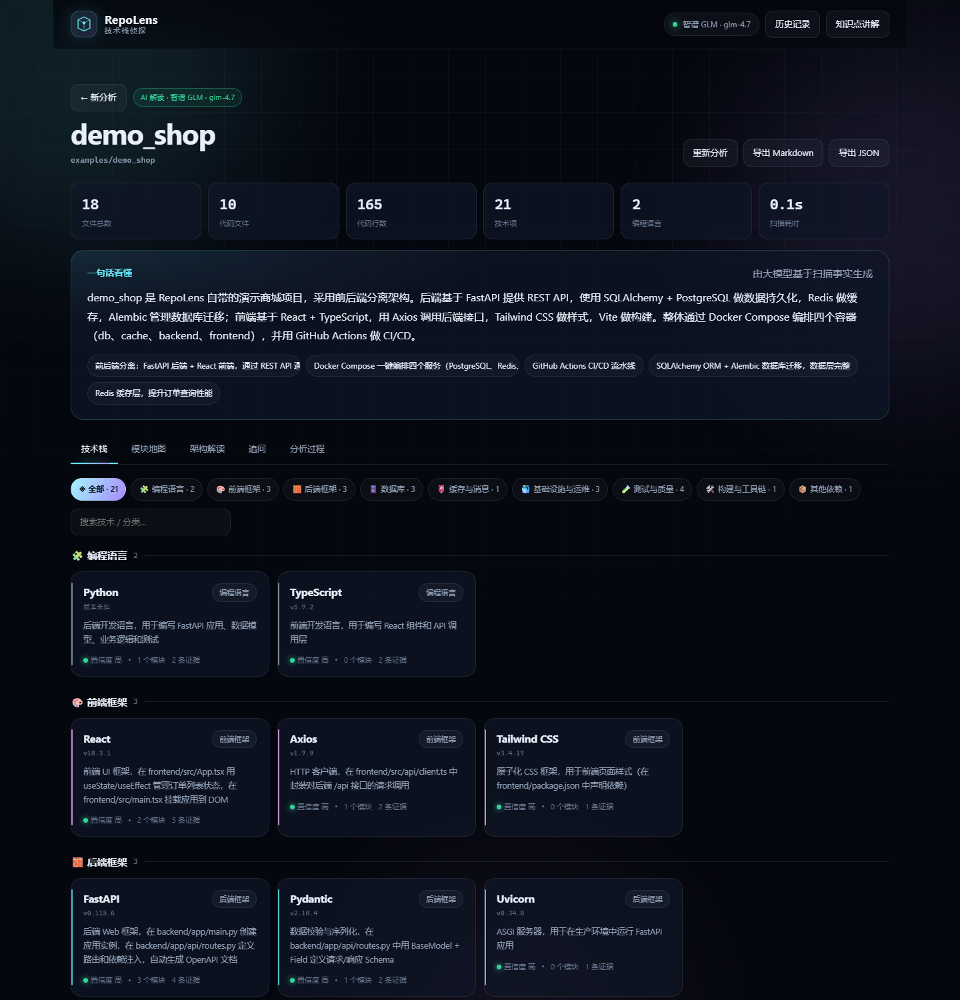

# 第 02 章：环境与第一次运行

> 阅读时间：45 分钟
> 前置：第 01 章
> 目标：把项目真正跑起来，并知道每个页面对应什么

---

## 2.1 你会学到

- 安装 Python 依赖；
- 创建 `.env` 并配置模型；
- 没有 API Key 时如何运行；
- 用 `demo_shop` 生成第一份报告；
- 首页、运行页、报告页分别看什么；
- GitHub 克隆为什么需要审批；
- 常见启动错误怎么排查。

---

## 2.2 检查环境

需要：

```text
Python 3.11+
可选：Node.js 20+（只改前端时需要）
```

检查：

```powershell
python --version
node --version
npm --version
```

如果 `python` 不是 3.11+，用 `py -3.11` 或安装新版。

> 只运行 RepoLens 不需要 Node，因为 `static/dist` 已经提交。
> 只有修改 `frontend/` 源码并重新构建时才需要 Node。

---

## 2.3 创建虚拟环境

在项目根目录 `repolens/` 下：

### Windows PowerShell

```powershell
python -m venv ..\.venv
..\.venv\Scripts\Activate.ps1
pip install -r requirements.txt
```

### macOS / Linux

```bash
python3 -m venv ../.venv
source ../.venv/bin/activate
pip install -r requirements.txt
```

为什么虚拟环境放在项目外面？

- 仓库根目录只放项目文件；
- `.venv` 在上一级，不会误提交；
- `AGENTS.md` 中的命令也统一使用 `..\.venv`。

---

## 2.4 配置模型（可选）

RepoLens 支持三类 OpenAI 兼容供应商，至少填一个：

```text
DEEPSEEK_API_KEY
GLM_API_KEY
OPENAI_API_KEY
```

### 步骤

```powershell
copy .env.example .env
notepad .env
```

填入例如：

```dotenv
DEEPSEEK_API_KEY=sk-你的真实密钥
```

或：

```dotenv
GLM_API_KEY=你的智谱密钥
```

保存后重新启动服务。

### 没有 Key 会怎样？

仍然可以使用：

- 扫描器全部功能；
- 规则报告；
- 技术栈、模块、依赖图；
- 风险面板的部分规则；
- 代码证据；
- 历史记录。

不能使用：

- AI 摘要、架构解读、AI 风险；
- 追问；
- 语义深度核对。

报告页会明确显示：

```text
仅规则扫描（未启用 AI 解读）
```

这不是失败，而是设计好的降级路径。

---

## 2.5 启动

```powershell
python run.py --open
```

默认地址：

```text
http://127.0.0.1:8765
```

如果 8765 被占用，服务会自动尝试 8766、8767，并在终端打印实际地址。

### 只验证服务

```powershell
curl http://127.0.0.1:8765/api/health
```

应返回类似：

```json
{
  "ok": true,
  "app": "RepoLens",
  "version": "1.0.0",
  "ai_available": true
}
```

---

## 2.6 第一次分析 demo

首页输入：

```text
examples/demo_shop
```

点击「开始分析」。

### 运行页会显示

- 四阶段时间线：检查环境 → 扫描仓库 → Agent 核实 → 生成报告；
- Agent 待办清单；
- 实时事件流（工具调用、扫描进度、阶段变化）；
- Token 用量；
- 克隆审批弹窗（仅 GitHub）。



### 报告页会显示

- 仓库名、来源、AI 状态；
- 文件 / 代码行数 / 技术项 / 风险提示；
- 先看什么：入口文件、核心依赖、首个风险、路线入口；
- 摘要与亮点；
- 5 个核心 Tab；
- 更多视图：依赖图、风险面板、分析过程。



---

## 2.7 界面导览

### 首页

```text
输入本地路径 / GitHub 地址
示例仓库
最近分析
```

### 运行页

```text
状态 / 耗时
阶段时间线
Agent 待办
实时工具流
Token
错误与重试
```

### 报告页

```text
报告头
4 格统计
先看什么
摘要
技术栈 / 模块地图 / 架构解读 / 学习路线 / 追问
更多视图
```

### 追问页

- 多轮对话；
- 技术深挖四模板；
- 回答下的引用核对；
- 可选语义深度核对。

---

## 2.8 GitHub 地址流程

输入例如：

```text
https://github.com/owner/repo
```

或简写：

```text
owner/repo
```

流程：

```text
Agent 决定调用 clone_github_repository
→ 弹出审批框
→ 你点“允许”
→ 克隆到 data/repos/
→ 只读扫描
```

如果点「拒绝」：

- 立即结束；
- 不会继续尝试克隆；
- 不会把拒绝当成“稍后重试”。

这是 Human-in-the-loop（HITL）设计。

> 只扫描公开仓库；不要把私有凭据写进 URL。

---

## 2.9 常见启动问题

### 端口被占用

服务会自动 +1。看终端打印的 URL，不要假设一定是 8765。

### 页面 503：前端尚未构建

说明 `static/dist` 缺失。
正常仓库已经提交构建产物。如果你删除了 `static/dist`：

```powershell
cd frontend
npm install
npm run build
```

### 模型未配置

检查：

```text
.env 是否存在
Key 是否为空
Key 是否还是示例占位符
```

### `pip install` 失败

- 确认 Python 3.11+；
- 升级 pip：

```powershell
python -m pip install --upgrade pip
```

- 网络问题可以换镜像源；
- 不要在系统 Python 里硬装，优先虚拟环境。

### 页面空白 / 控制台报错

- 打开浏览器开发者工具 Console；
- 看 Network 里 `/api/report` 是否 404；
- 确认报告真的已经生成（运行页是否完成）；
- 刷新页面，前端会用 `run_id` 恢复。

---

## 2.10 第一次动手

完成下面四件事：

1. 无 Key 跑一次 `demo_shop`，确认有规则报告；
2. 有 Key 再跑一次，比较摘要与风险的变化；
3. 打开一项技术的详情，点击证据路径，看代码查看器；
4. 问一个追问：

```text
我应该先读哪些文件？
```

观察回答下面是否出现“引用可核对”。

---

## 2.11 自测

1. 为什么只装 Python 也能运行？
2. 没有 API Key 时哪些功能不可用？
3. GitHub 克隆为什么要审批？
4. `static/dist` 缺失会怎样？
5. 运行页和分析流水线是什么关系？

能回答后进入：[03 目录结构与请求生命周期](03-目录结构与请求生命周期.md)。
